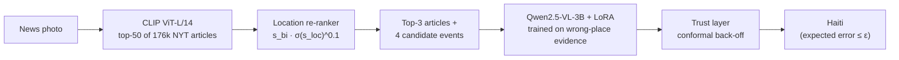

# Geotag

Where and when was this news photo taken? Geotag retrieves news articles for a photo, lets a fine-tuned vision-language model weigh that evidence, and answers only as precisely as the evidence allows, with a conformal bound on the error rate.

> Photo of a collapsed building, no caption.
> Without the trust layer: **Port-au-Prince, Haiti, 2010-01-19**, which may be wrong in the city or the day.
> With the trust layer at ε = 10%: **Haiti**, and no date unless the model is confident enough, so that the expected error of what it does say stays at most 10%.

## How it works



1. **Retriever.** Frozen CLIP ViT-L/14 scores 176,314 NYT articles (2010–2021, headline + abstract) against the photo and keeps the top 50. A small MLP re-ranks them by how well each article's location fits the photo; its weight α = 0.1 is chosen on the dev set.
2. **Generator.** Qwen2.5-VL-3B-Instruct reads the photo, the top-3 articles and four candidate (location, date) events built from the top-20 articles. LoRA (r = 64, vision tower frozen) trains it on 6,000 TARA examples in three formats (direct answer, multiple choice, verdict per article). In 15% of the examples every article is from the wrong place, so the model learns to reject evidence instead of copying it.
3. **Trust layer** (`nv/hierarchy.py`). Turns the model's multiple-choice probabilities into an answer at the right level of detail, described below.

## Trust layer

Each candidate event k gets a probability $p_k$ from the model's first answer token. Its location resolves through the GeoNames gazetteer to the path country > region > city, its date to year > month > day. Starting from the most likely candidate $k^\ast$, the confidence of the node at depth $l$ of its path is the probability of all candidates that share that node:

$$c_l = \sum_k p_k \, \mathbf{1}\left[\mathrm{path}_k[{:}l] = \mathrm{path}_{k^\ast}[{:}l]\right], \qquad c_1 \ge c_2 \ge c_3 .$$

Geotag answers with $k^\ast$'s node at the finest depth where $c_l \ge \lambda$, and gives no answer when even the country (or year) is below $\lambda$. Along one path, a correct city implies a correct region and country, so the error of the committed answer can only fall as $\lambda$ grows. That makes conformal risk control applicable: on the $n$ dev images,

$$\hat\lambda = \min\left\{\lambda : \frac{n \, \hat R_{\text{dev}}(\lambda) + 1}{n + 1} \le \varepsilon\right\}
\quad\Longrightarrow\quad \mathbb{E}\left[\text{error on a new image}\right] \le \varepsilon ,$$

assuming dev and test images are exchangeable. The guarantee holds on average over calibration sets, not for every single split.

The layer is compared with two baselines on the same images: **finest** (always answer with full detail) and **selective** (the same calibration on $p_{k^\ast}$ alone, answering in full or not at all). It reports, for ε ∈ {5%, 10%, 20%}, the test error, the share of images answered, the share answered at each depth, and specificity (mean depth / 3).

On synthetic probabilities over the real TARA labels, the average test error over 200 random dev/test splits was 4.91%, 9.90% and 19.75% for ε = 5%, 10% and 20% (location) and 4.99%, 9.93% and 19.84% (date). Synthetic probabilities cannot show whether back-off beats the selective baseline; the real model's outputs are under Results.

## Results

One training run (seed 0), scored on the 1,571 TARA test images that have a gold location or date (location n = 1,476, date n = 1,303). Brackets are 95% bootstrap intervals over images (1,000 resamples); gains are paired against the photo-only baseline. `GREAT@500` scores the 500-image subset of the NewsVQA-lite reference run, whose own numbers are in the last column.

| Run | GREAT [95% CI] | Gain vs photo only [95% CI] | Location EM@1 | Date EM@1 | Correct → wrong location | GREAT@500 | Reference @500 |
|---|---|---|---|---|---|---|---|
| Retrieval only (re-ranked top-1) | 55.6 [54.2, 56.8] | +3.1 [1.6, 4.7] | 24.7 | 3.9 | 206 | 54.8 | 54.7 |
| Qwen2.5-VL-3B, photo only | 52.4 [51.1, 53.8] | – | 27.6 | 2.4 | – | 51.1 | 51.1 |
| 3B + top-3 articles | 57.2 [55.9, 58.6] | +4.8 [3.5, 6.1] | 30.9 | 3.9 | 108 | 57.1 | 57.2 |
| 3B + top-3 articles, multiple-choice prompt | 53.4 [52.0, 54.9] | +1.0 [−0.4, 2.5] | 24.5 | 3.5 | 179 | 53.9 | 54.0 |
| **3B + LoRA, direct answer** | **62.7 [61.4, 63.9]** | **+10.2 [8.9, 11.5]** | **45.5** | 4.3 | **29** | 62.9 | 62.5 |
| 3B + LoRA, multiple choice | 62.8 [61.4, 64.1] | +10.3 [9.0, 11.6] | 45.1 | 4.6 | 38 | 62.9 | 61.9 |

"Correct → wrong location" counts test images whose location was right from the photo alone and turned wrong in that run (blind trust in the articles).

- **Reproduction.** On the reference run's 500 images every system lands within 1.0 GREAT of the reference; retrieval matches as well (location R@1 55.05 on dev and 56.1 on test, against 55.1 and 56.3, re-ranker weight α = 0.1). The reference run's zero-shot Qwen2.5-VL-7B with the same articles scored 57.8 on its 500 images; it is not re-run here.
- **Fine-tuning.** LoRA adds 5.5 GREAT over the same 3B model given the same articles (62.7 vs 57.2; the intervals do not overlap) and lifts location EM@1 from 30.9% to 45.5%. Blind-trust errors fall from 108 to 29 images, while images whose location the articles fix rise from 157 to 294.
- **Calibration.** The expected calibration error of the multiple-choice confidence falls from 24.8 (zero-shot) to 19.2 (LoRA).
- **Exact dates stay hard.** Date EM@1 is at most 4.6% for every system.

### Trust layer on the test set

λ is calibrated on the dev multiple-choice run (1,474 images with a resolvable gold location, 1,312 with a gold date) and scored on test (1,471 and 1,299). Depth 1/2/3 is country/region/city or year/month/day.

| Dimension | ε | Method | Test error % | Answered % | Depth 1/2/3 % | Specificity % |
|---|---|---|---|---|---|---|
| Location | – | finest | 48.4 | 98.8 | 40 / 9 / 50 | 69.1 |
| Location | 5% | **back-off** | 5.8 | **40.4** | 29 / 4 / 7 | **19.7** |
| Location | 5% | selective | 6.2 | 29.9 | 17 / 3 / 11 | 17.9 |
| Location | 10% | **back-off** | 12.2 | **56.4** | 35 / 6 / 15 | **31.2** |
| Location | 10% | selective | 11.8 | 48.3 | 26 / 4 / 19 | 29.8 |
| Location | 20% | **back-off** | 21.1 | **72.9** | 40 / 7 / 26 | **44.0** |
| Location | 20% | selective | 20.5 | 63.8 | 31 / 5 / 28 | 41.5 |
| Date | – | finest | 96.5 | 100.0 | 0 / 0 / 100 | 100.0 |
| Date | 5% | back-off | 6.4 | 7.4 | 2 / 1 / 5 | 6.0 |
| Date | 5% | selective | 6.5 | 6.9 | 0 / 0 / 7 | 6.9 |
| Date | 10% | back-off | 11.6 | 13.5 | 3 / 2 / 9 | 11.3 |
| Date | 10% | selective | 10.7 | 11.2 | 0 / 0 / 11 | 11.2 |
| Date | 20% | back-off | 22.2 | 24.7 | 3 / 2 / 19 | 21.9 |
| Date | 20% | selective | 20.8 | 21.9 | 0 / 0 / 22 | 21.9 |

- **Location.** At the same target, back-off answers 8 to 10 points more images than the selective baseline (56.4% vs 48.3% at ε = 10%) with test error within 0.6 points of it: where the selective rule stays silent, back-off still names the country.
- **Error above target on this split.** For both methods and both dimensions the test error is 0.8 to 2.2 points above ε. The bound holds on average over calibration sets, so a single split can land above it; a check that pools dev and test and re-splits them many times is the next step before claiming the bound holds here.
- **Dates.** The model is rarely confident about dates: even at ε = 20% only a quarter of the images get one, and backing off to the year or month happens for at most 3% and 2% of images.

## Run it

**Data** (not in this repository):

| What | Source | Where it goes |
|---|---|---|
| TARA labels and images | [github.com/zeyofu/TARA](https://github.com/zeyofu/tara) | `data/TARA_dataset/{input,img/{train,dev,test}}` |
| NYT articles 2010–2021 | NYT Archive API, one JSON file per year | `data/processed_articles/nyt_articles_<year>.json` |
| GeoNames | `cities15000.zip`, `countryInfo.txt`, `admin1CodesASCII.txt` from [download.geonames.org](https://download.geonames.org/export/dump/), plus NewsRECON's `geonames_results.json` | `runs_3b/geonames/` |

**1. Build the corpus on a laptop** (CPU, about 15 s; needs only the Python standard library):

```bash
NV_OUT=runs_3b python -m nv.prepare
```

**2. Run everything else on Colab** with [`notebooks/geotag_colab.ipynb`](notebooks/geotag_colab.ipynb): put `data/tara_img.zip` (a zip of `data/TARA_dataset/img`), `runs_3b/prepared/` and `runs_3b/geonames/` in `My Drive/geotag/`, add a read-only GitHub token as the Colab secret `GH_TOKEN`, choose an L4 GPU and run all cells. Each step writes to Drive and is skipped once done, so a disconnected session resumes where it stopped. Expect about 4–5 L4 hours.

On a machine with its own GPU, `bash scripts/run_all.sh` runs the same steps.

| Step | Command |
|---|---|
| CLIP embeddings, retrieval, re-ranker | `python -m nv.embed`, `python -m nv.retrieve`, `python -m nv.cross_encoder` |
| Training and evaluation data | `python -m nv.build_sft --n_train 6000 --n_eval 1644 --noise 0.15` |
| LoRA training | `python -m nv.train_lora --out ckpt/lora_mixed` |
| Inference | `python -m nv.infer --split test --fmt mcqa --name lora_mixed_mcqa --adapter ckpt/lora_mixed/final` |
| Scores, intervals, flips | `python -m nv.evaluate --split test --baseline zs_noev` |
| Trust layer | `python -m nv.hierarchy --name lora_mixed_mcqa` |
| Summary for the paper | `python scripts/extract_metrics.py --src runs_3b/results --out runs_3b/metrics_summary.json` |
| Demo | `python demo.py --adapter ckpt/lora_mixed/final --share` |

## Repository layout

```
nv/                    one module per stage (python -m nv.<stage>)
  prepare.py           corpus filter and TARA normalisation (removes every dev/test source article)
  embed.py, retrieve.py, cross_encoder.py    retrieval
  build_sft.py         training and evaluation prompts
  train_lora.py, infer.py                    fine-tuning and batched generation
  evaluate.py, metrics.py, geo.py            scores, bootstrap intervals, gazetteer
  hierarchy.py         trust layer
notebooks/             geotag_colab.ipynb
scripts/               run_all.sh, extract_metrics.py, plot_loss.py
results/               reference numbers (NewsVQA-lite run)
demo.py                Gradio app
```

`ARCHITECTURE_GUIDE.md` maps every equation to the line of code that implements it.

## Metrics

- **GREAT**: mean of a date score and a location score, each 0–100 with partial credit (introduced by Siingh et al., 2025; this code follows NewsRECON's implementation, which scores the date and location parts only).
- **EM@1**: exact match; a location counts if the most specific gold place name appears in the answer.
- **Correct → wrong flips**: test images whose location was right from the photo alone and turned wrong once articles were added, i.e. blind trust in evidence.
- **ECE**: expected calibration error of the multiple-choice confidence, 10 bins.

## Credits and related work

The retrieval and fine-tuning pipeline follows NewsVQA-lite (2026). This repository rebuilds it from scratch, evaluates on the full TARA test set with bootstrap intervals, and adds the conformal trust layer.

- NewsRECON: Tonglet et al., [arXiv:2601.14121](https://arxiv.org/abs/2601.14121), retrieval design and evaluation protocol.
- LiveVQA: Fu et al., [arXiv:2504.05288](https://arxiv.org/abs/2504.05288), the three training formats.
- TARA: Fu et al., ACL 2022, [dataset](https://github.com/zeyofu/tara).
- GETReason (GREAT metric): Siingh et al., [arXiv:2505.21863](https://arxiv.org/abs/2505.21863).
- Conformal risk control: Angelopoulos et al., ICLR 2024, [arXiv:2208.02814](https://arxiv.org/abs/2208.02814).
- Closest ideas to the trust layer: conformal factuality (Mohri and Hashimoto, [ICML 2024](https://proceedings.mlr.press/v235/mohri24a.html)), hierarchical selective classification (Goren et al., NeurIPS 2024, [arXiv:2405.11533](https://arxiv.org/abs/2405.11533)), conformal linguistic calibration (Jiang et al., [arXiv:2502.19110](https://arxiv.org/abs/2502.19110)) and C-RAG (Kang et al., [ICML 2024](https://proceedings.mlr.press/v235/kang24a.html)). Geotag applies calibrated back-off to two hierarchies at once (place and time) for retrieval-augmented, multimodal answers.

## Limitations

- All results come from one training run (seed 0). The intervals cover the choice of test images, not training randomness; seeds and the noise-rate ablation are still to run.
- The corpus is NYT only, 2010–2021, and the CLIP encoders are frozen, so absolute numbers are not comparable with the NewsRECON paper.
- The trust layer's bound is an average over calibration sets and assumes dev and test images are exchangeable; on the one dev → test split reported here the test error sits 0.8 to 2.2 points above the target. It says nothing about photos from other sources.
- Place names the gazetteer cannot resolve count as errors, and a gold answer coarser than the committed one is judged at the gold's level.
